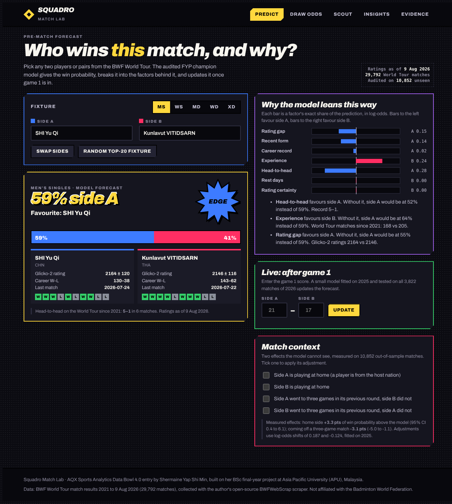

# Squadro Match Lab

**Badminton match intelligence for coaches.** Pick any two players or pairs from the BWF World Tour and get an audited win probability, the exact factors behind it, an update after game 1, the odds of winning a 16-entry draw, and a scouting profile, all in the browser.

**Live demo:** https://shermaineyap.github.io/squadro-match-lab/

**Demo video (2.5 min):** https://youtu.be/sDo82qeMfs4



Built for the **AQX Sports Analytics Data Bowl 4.0** by Shermaine Yap Shi Min (Asia Pacific University of Technology and Innovation, Malaysia).

---

## The problem

A badminton coach preparing for a World Tour event has to answer the same questions every week. How strong is the next opponent, really? How much should the draw worry us? Was that loss bad luck or a warning sign? Rankings answer slowly and say nothing about a specific match-up. Black-box predictions answer quickly but cannot say *why*.

Squadro Match Lab answers those questions with numbers a coach can check.

## What it does

| View | For the coach |
| --- | --- |
| **Predict** | Win probability for any fixture in all five disciplines, broken into seven plain-English factors (rating gap, recent form, career record, experience, head-to-head, rest, rating certainty). Each factor shows how far the probability would move without it. |
| **Live: after game 1** | Enter the game-1 score and get an updated match probability. Tested out of time on all of 2026: ROC-AUC rises from 0.798 before the match to 0.901 after game 1. |
| **Match context** | Optional adjustments for two effects the model cannot see: home advantage and fatigue from a three-game previous round. |
| **Draw odds** | Exact title odds for a 16-entry knockout (no random sampling), a reshuffle button, and a "draw luck" range showing how much the draw alone moves each contender. |
| **Scout** | Power rankings, rating history since 2021, last-10 form, and 2026 *wins above expectation*: actual wins minus the wins the model expected before each match. |
| **Insights** | Six findings from 10,852 matches the model never trained on, each with a 95% interval and a coaching action. |
| **Evidence** | Audit metrics for both unseen seasons, calibration, per-discipline strength, and a live check that the browser reproduces the original Python model exactly. |

## Key findings (out-of-sample, 2025 and 2026 seasons)

All intervals are 95% bootstrap intervals that resample whole tournaments.

1. **Home players beat the model by +3.3 percentage points** (CI +0.4 to +6.1; 2,797 matches). The champion model cannot see home advantage, because context shared by both sides cancels out under its order symmetry.
2. **A three-game match costs you next round: −3.1 points** of win probability against an opponent who won in two (CI −5.0 to −1.1; 2,072 matches).
3. **Game 1 decides most matches.** 82.5% of game-1 winners take the match. An underdog (under 35%) who wins game 1 goes on to win 57.6% of the time.
4. **Men's singles is the hardest event to call** (ROC-AUC 0.73; one favourite in three loses). Women's doubles is the easiest (ROC-AUC 0.86; 22% upsets).
5. **Upsets peak in finals.** Favourites win 74% of round-of-32 matches but only 65% of finals.
6. **Rating gaps are interpretable.** Under 50 Glicko-2 points the stronger side wins 51%. Above 450 points it wins 93%.

## The model

The engine is the champion model from my BSc final-year project, frozen before it ever saw 2025 or 2026 data.

* **Order-symmetric logistic regression** on 20 pre-match features: Elo and Glicko-2 rating gaps, recent form over 5 and 10 matches, experience, career win rate, partnership history, rest days and head-to-head. Trained on 17,193 BWF World Tour matches from 2022 to 2024.
* **Symmetry by construction.** Every fixture is scored both ways round and averaged in log-odds, so P(A beats B) = 1 − P(B beats A) exactly.
* **No leakage.** Features are built date-batched: every match on a date is rated only from matches before that date.

| Unseen season | Matches | ROC-AUC (95% CI) | Accuracy | Brier |
| --- | ---: | --- | ---: | ---: |
| 2025 | 7,030 | **0.808** (0.795–0.822) | 72.9% | 0.179 |
| 2026, to 9 Aug | 3,822 | **0.798** (0.782–0.814) | 71.7% | 0.185 |

Full details and limitations are in [docs/bwf_champion_model_card.md](docs/bwf_champion_model_card.md).

### Why it runs in the browser

Because the model averages both orientations, the intercept, the tournament context and everything else that is identical for both sides cancel algebraically. What remains is a short weighted sum of differences. `pipeline/build_data.py` extracts those weights from the frozen scikit-learn bundle and **asserts** that the portable form reproduces the served model on all 10,852 audit matches (largest difference 3.3 × 10⁻¹⁶). The Evidence view repeats the check live in the browser against 60 fixtures scored by the original Python service.

The result is a static site: no server, no API keys, instant answers, and every number explainable.

## What is new for this hackathon

The rating engine, features and champion model come from my final-year project (`fyp/`, MIT licensed). Everything else was built for the Data Bowl:

* the portable, exactly-verified browser form of the model, and the static app around it
* the factor breakdown with "without this factor" counterfactuals
* the in-match game-1 model and its out-of-time test on 2026
* the home-advantage and fatigue analyses, and the context adjustments
* the exact knockout-bracket calculator and draw-luck analysis
* wins above expectation, power rankings and rating histories
* the six findings, upset list and evidence view

## Data

29,792 completed BWF World Tour matches from 12 January 2021 to 9 August 2026, all five disciplines, collected with my open-source scraper [BWFWebScrap](https://github.com/ShermaineYap/BWFWebScrap) from BWF's public results. Ratings in the app are a snapshot as of 9 August 2026. Squadro Match Lab is not affiliated with the Badminton World Federation.

## Run it

The app is plain HTML and JSON. Serve the folder with any static server:

```bash
python -m http.server 8000
# open http://localhost:8000
```

Rebuild every data file from the frozen FYP artefacts (about 15 seconds):

```bash
pip install -r requirements.txt
python pipeline/build_data.py
```

The build is deterministic: rerunning it reproduces `data/*.json` byte for byte.

## Repository layout

```
index.html              the whole app (HTML, CSS and JS in one file)
data/                   JSON the app loads, generated by the pipeline
pipeline/build_data.py  model export, verification, analyses
fyp/                    frozen FYP artefacts: source, champion bundle, rating snapshots, cleaned data, audit predictions
docs/                   model card and screenshots
```

## Limitations

* Ratings stop at 9 August 2026; later results are not reflected.
* The 0.80 ROC-AUC target was met in 2025 but not in 2026. Both intervals contain 0.80.
* Probabilities are uncalibrated, and 2026 calibration is weaker than 2025 (ECE 0.038 against 0.014).
* The home and fatigue effects are associations measured against the model, not causal estimates. Adding them to the model improved 2026 log loss, but not clearly more than simply rescaling the model's margin, so the app presents them as optional context.
* A doubles pair that has never played together starts from a default partnership rating.

## License

MIT. See [LICENSE](LICENSE).
